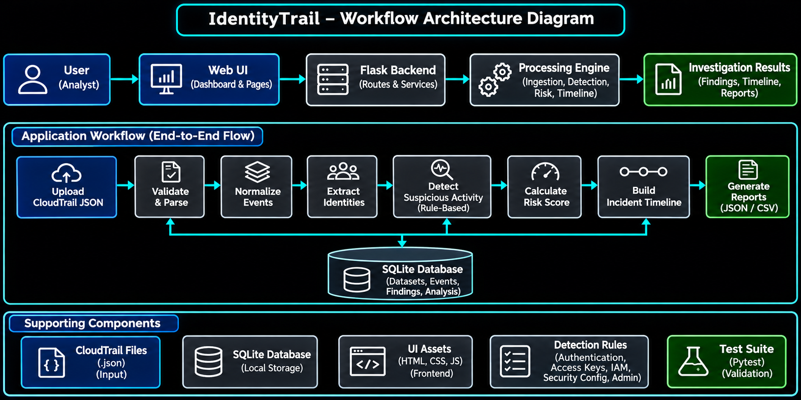
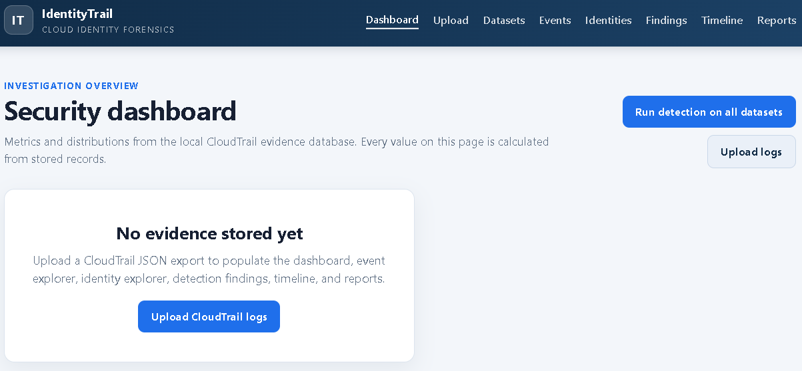
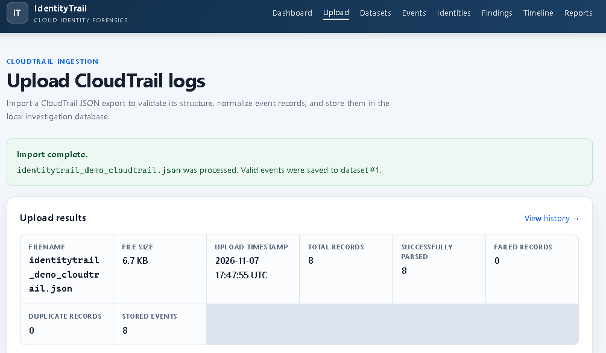
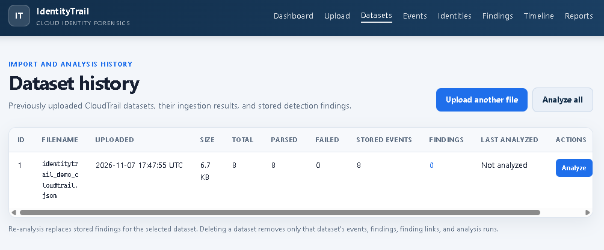
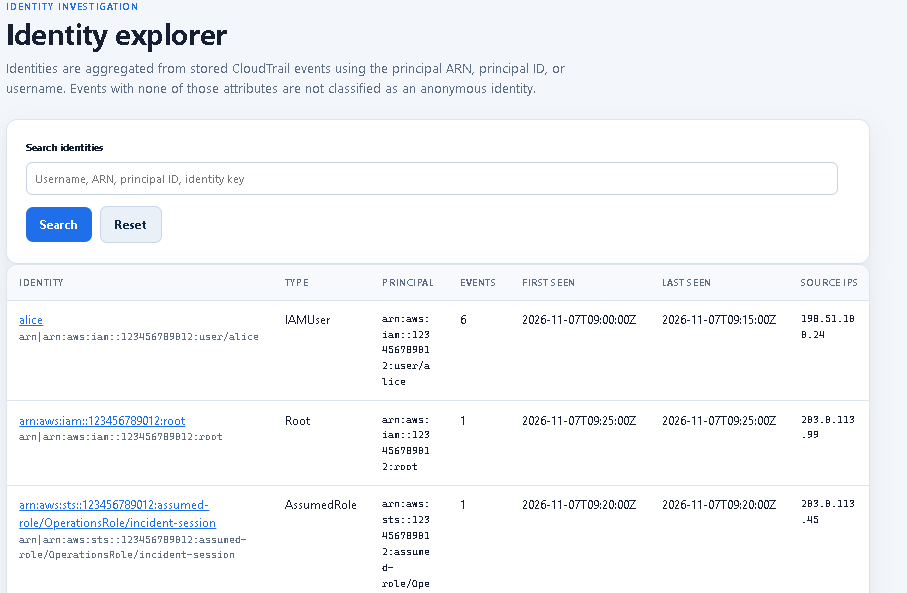
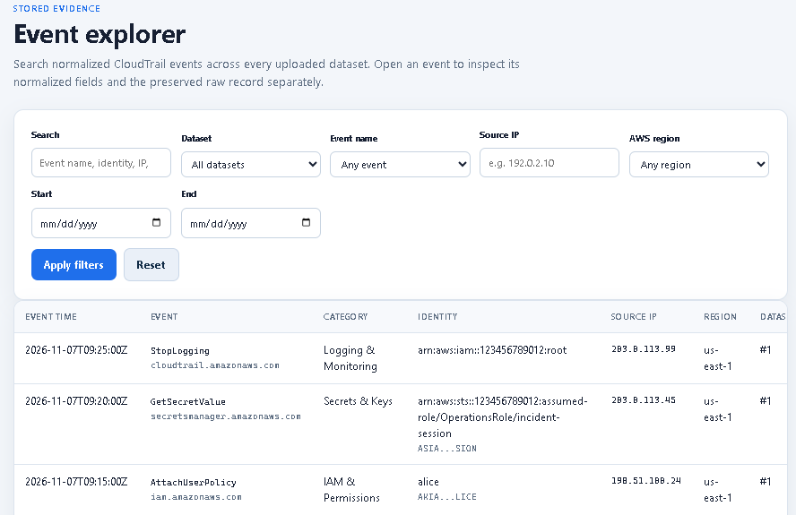
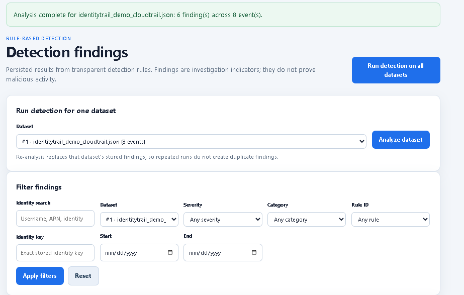
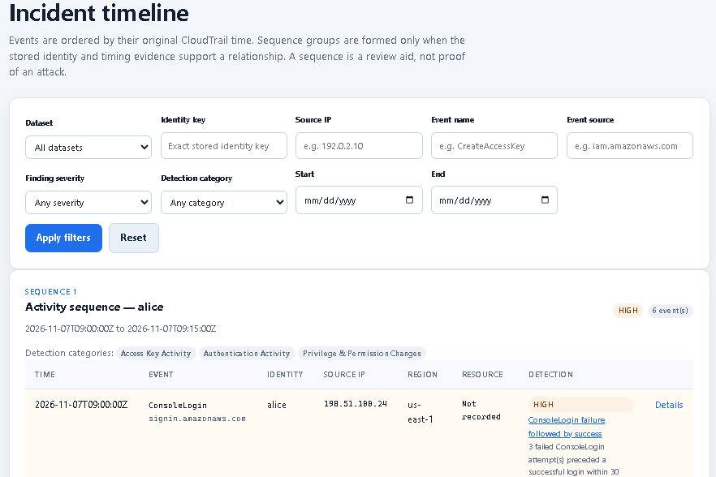
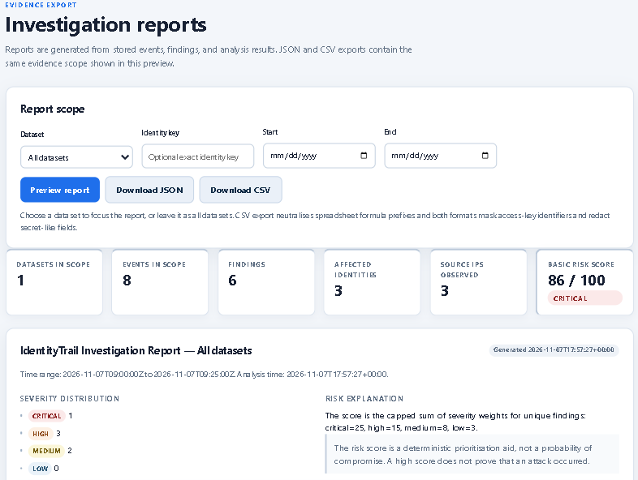

# IdentityTrail

IdentityTrail is a local-first AWS CloudTrail investigation and forensics workbench. It imports CloudTrail JSON into SQLite, provides identity and event explorers, detects suspicious activity using transparent rule-based detection, builds investigation timelines, and generates evidence-linked investigation reports.

It helps security analysts investigate AWS identity activity and identify potentially suspicious operations through structured event analysis.

Findings are indicators for analyst review, not proof of compromise.

## Basic-Phase Features

- **CloudTrail ingestion:** Validates and ingests `Records` arrays, single events, and lists of events. Malformed records are reported while valid records are retained. Uploads are limited to 10 MiB and 10,000 records by default. Duplicate CloudTrail event IDs are skipped within a dataset.

- **Event normalization:** Extracts and normalizes CloudTrail event fields, preserves original event records in the local database, and displays raw and normalized details with sensitive values redacted.

- **Identity analysis:** Discovers identities using available principal ARNs, principal IDs, usernames, identity types, and access-key information. Assumed-role sessions remain distinct sessions and are not automatically attributed to the human who assumed the role.

- **Identity and event exploration:** Provides searchable and filterable identity, event, finding, and timeline views.

- **Rule-based threat detection:** Detects suspicious patterns including repeated console-login failures, failure-followed-by-success sequences, authentication API errors, access-key creation/deletion/update and post-creation use, IAM policy and trust changes, group membership changes, CloudTrail logging changes, sensitive resource deletion, high-impact administrative operations, and secrets/decryption access.

- **Explainable findings:** Each finding includes its detection rule, severity, trigger explanation, supporting evidence, linked events, and recommended investigation steps. Failed API calls do not count as completed state changes; authentication failures remain detection evidence.

- **Risk scoring:** Calculates deterministic risk scores using severity weights (critical 25, high 15, medium 8, low 3), capped at 100. Scores prioritize investigation and are not probabilities of compromise.

- **Incident timeline:** Builds chronological event sequences and connects detected findings to their supporting CloudTrail events.

- **Investigation reports:** Generates scoped JSON and CSV reports containing investigation summaries, risk information, findings, and supporting event details. CSV cells are protected against spreadsheet formula injection.

- **Dashboard analytics:** Displays metrics calculated from stored database records, including event counts, findings, severity distribution, and investigation activity.

- **Dataset management:** Supports dataset analysis, re-analysis, and transactional deletion of datasets with their dependent records.

## Workflow Architecture



## Application Screenshots

### 1. Dashboard

The dashboard provides an overview of imported CloudTrail activity, investigation metrics, risk scores, finding severity, and recent security findings.



### 2. CloudTrail Upload Results

Upload CloudTrail JSON files and review ingestion results, including successfully parsed events, failed records, and duplicate events.



### 3. Dataset History

Manage imported CloudTrail datasets, review ingestion statistics, and run or manage investigations for individual datasets.



### 4. Identity Explorer

Explore identities discovered from CloudTrail events. Review identity types, principal information, activity counts, and associated investigation data.



### 5. Event Explorer

Search and filter CloudTrail events using event names, identities, sources, timestamps, and other available attributes.



### 6. Security Findings

Review suspicious activity identified by the detection engine, including finding severity, detection rules, trigger explanations, and supporting evidence.



### 7. Incident Timeline

Investigate chronological CloudTrail activity and examine relationships between events, identities, and detected findings.



### 8. Investigation Reports

Generate investigation summaries with risk scores, findings, supporting evidence, event coverage, and JSON/CSV export options.



## Architecture

IdentityTrail follows a modular Flask application architecture.

- `app.py` initializes the Flask application and registers routes.
- `config.py` manages application configuration and environment variables.
- `database.py` manages SQLite schema initialization, migrations, indexes, transactions, and database access.
- `routes/` contains Flask blueprints for dashboard, datasets, identities, events, findings, timeline, analysis, and reports.
- `services/` contains CloudTrail parsing, normalization, ingestion, identity analysis, detection orchestration, risk scoring, timeline generation, and report generation.
- `rules/` contains the rule definitions and detection evaluators.
- `templates/` contains the Jinja HTML templates.
- `static/` contains local CSS and JavaScript assets.
- `tests/` contains automated tests.
- `sample_data/` contains synthetic CloudTrail demonstration data.
- `instance/` contains the local SQLite database.
- `screenshots/` contains application screenshots used in this README.

**Technology Stack:** Python, Flask, SQLite, Jinja, HTML, CSS, JavaScript, and pytest.

No external service, CDN, AWS credentials, or JavaScript package installation is required for the core application.

## Windows Setup

From PowerShell, navigate to the project directory.

### 1. Create a virtual environment

```powershell
py -3 -m venv .venv
```

### 2. Activate the environment

```powershell
.\.venv\Scripts\Activate.ps1
```

Activation is optional. You can also run commands directly using the virtual environment's Python executable.

### 3. Install dependencies

```powershell
python -m pip install -r requirements.txt
```

### 4. Start IdentityTrail

```powershell
.\.venv\Scripts\python.exe app.py
```

Open the application:

**http://127.0.0.1:5000/dashboard**

The application binds to `127.0.0.1` by default. The `/health` endpoint provides a basic health check, while `/` retains the JSON application-status response.

## Running Tests

Run the automated test suite:

```powershell
.\.venv\Scripts\python.exe -m pytest -q
```

The test suite covers CloudTrail parsing, event normalization, ingestion, database operations, upload routes, and investigation workflows.

## Investigation Workflow

1. **Upload CloudTrail Data:** Select a `.json` CloudTrail export containing a `Records` array. Single-event objects and event arrays are also supported.
2. **Review Ingestion Results:** Examine successfully parsed records, failed records, and duplicate events.
3. **Explore Identities:** Use the Identity Explorer to investigate discovered identities and their associated activity.
4. **Explore Events:** Search and filter stored CloudTrail events. Review normalized fields and redacted raw event details.
5. **Run Detection:** Start analysis from the dashboard, dataset history, or findings page.
6. **Investigate Findings:** Review severity, detection explanations, supporting evidence, linked events, and recommended investigation steps.
7. **Examine the Timeline:** Review chronological activity and relationships between events and findings.
8. **Generate Reports:** Create scoped investigation reports and export results in JSON or CSV format.
9. **Manage Datasets:** Delete datasets when they are no longer required. Associated events, findings, and analysis records are removed transactionally.

## Sample Data

A synthetic CloudTrail dataset is included in:

```text
sample_data/cloudtrail_sample.json
```

It can be used to test the upload, ingestion, normalization, identity exploration, and detection workflow without connecting to an AWS account.

The sample data is intended for demonstration and testing, not as a representation of actual AWS activity.

## Configuration and Data

IdentityTrail uses SQLite for local data storage.

The default database location is:

```text
instance/identitytrail.db
```

Database schema initialization is idempotent, and existing datasets are preserved during normal application startup. Tests use temporary databases.

The application creates the configured database directory if it does not exist.

### Environment Variables

The following environment variables can be used to configure the application:

| Variable | Default |
|---|---:|
| `IDENTITYTRAIL_DATABASE_PATH` | `instance/identitytrail.db` |
| `IDENTITYTRAIL_SECRET_KEY` | Random per process |
| `IDENTITYTRAIL_MAX_UPLOAD_BYTES` | `10485760` (10 MiB) |
| `IDENTITYTRAIL_MAX_EVENT_COUNT` | `10000` |
| `IDENTITYTRAIL_CONSOLE_FAILURE_THRESHOLD` | `3` |
| `IDENTITYTRAIL_CONSOLE_FAILURE_WINDOW_MINUTES` | `15` |
| `IDENTITYTRAIL_FAILURE_SUCCESS_WINDOW_MINUTES` | `30` |
| `IDENTITYTRAIL_ACCESS_KEY_ACTIVITY_WINDOW_HOURS` | `24` |
| `IDENTITYTRAIL_TIMELINE_GAP_MINUTES` | `60` |
| `IDENTITYTRAIL_PAGE_SIZE` | `50` |
| `IDENTITYTRAIL_REPORT_EVENT_LIMIT` | `500` |

The database path can also be configured through `DATABASE_PATH` in a Flask configuration object.

Report event-detail limits control the number of event records included in a report. Exact aggregate counts and omitted-detail counts are reported separately.

## Security and Privacy

- Uploaded content is parsed as data and is never executed.
- The original uploaded file is not stored separately. Raw CloudTrail event JSON is retained in SQLite for investigation purposes.
- Browser state-changing requests require session CSRF tokens and include origin and cross-site request checks.
- Session cookies are HTTP-only and use `SameSite=Lax`.
- SQL values are parameterized, and SQLite foreign keys are enabled per connection.
- Ingestion, analysis, and deletion operations use database transactions.
- Access-key IDs are masked in views and exports.
- Secret-like JSON fields are redacted in evidence views and reports.
- CSV exports protect against spreadsheet formula injection.
- The application runs on localhost by default and does not require AWS credentials or external services.

**Important:** The local SQLite database contains raw investigation evidence and should be treated as sensitive data. Keep databases and real CloudTrail exports out of version control and restrict access to the workstation.

IdentityTrail does not currently provide user authentication or multi-user authorization. It is intended for a trusted local workstation, not exposure to a network or untrusted users.

## Known Limitations

- Detection rules are deterministic and depend on CloudTrail event names, available fields, and logging coverage. They do not establish malicious intent.
- Assumed-role sessions are not automatically linked to the originating human or workload.
- Risk scores are prioritization aids, not probabilities of compromise.
- Detection results can contain false positives and require analyst review.
- Large reports may omit event or finding details according to configured limits. Omission counts are included in report coverage information.
- Identity discovery is based on available CloudTrail identity attributes.
- The Basic phase does not include threat-intelligence enrichment, cross-account correlation, attack-path reconstruction, or cloud-hosted services.

## Project Scope

IdentityTrail focuses on local AWS CloudTrail investigation, identity activity analysis, explainable rule-based detections, chronological investigation, and evidence-linked reporting.

It is designed as a lightweight investigation workbench and is not intended to replace a SIEM, EDR, or dedicated incident-response platform.